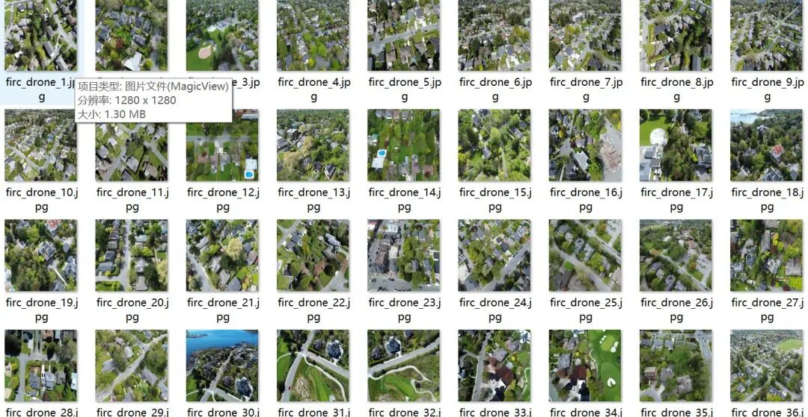
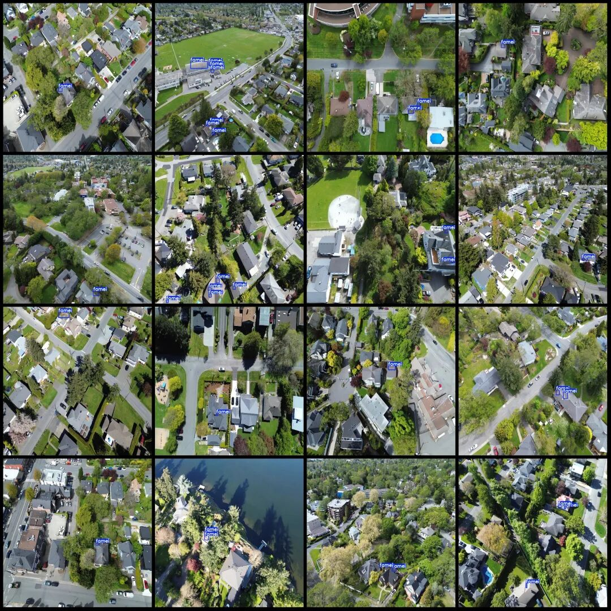
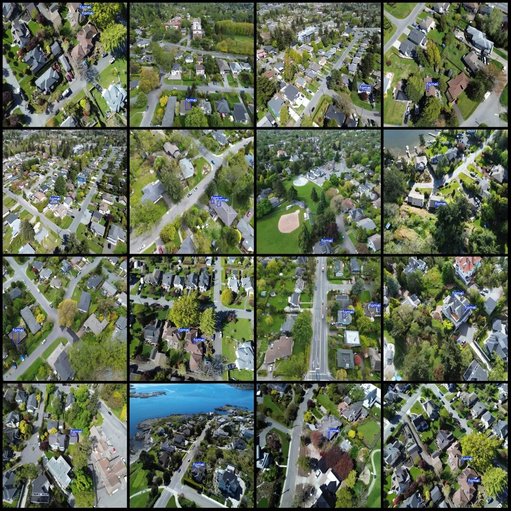

# UAV Perspective Roof Mold Detection Dataset VOC+YOLO format with 62 images in 1 category

Dataset format: Pascal VOC format + YOLO format (txt file without split path, only containing jpg images and corresponding VOC format xml files and yolo format txt files)

Number of images (number of jpg files): 62

Number of annotations (number of xml files): 62

Number of annotations (number of txt files): 62

Label category count: 1

Label category name: ["famei"]

Number of boxes labeled in each category:

famei (mold) frame count = 142

Total frame count: 142

Number of images per category:

Famei's possession of images = 62

Image resolution: 1280x1280

Using labelImg:

Drone: DJI MAVIC 3

Collection height: 100m

Sampling angle: 80-90°

Annotation rules: Draw a rectangle around the category.

Important Notice: The dataset does not have separate training, validation, and test sets; you need to partition them yourself.

Special : This dataset does not guarantee the accuracy of the trained models or weight files.

Image Preview:

Annotation example:

## Payment

Here is a pay link on Stripe ( https://buy.stripe.com/3cs8yP7sY87d0vu9AB ). Please contact me lonlonago@foxmail.com after funding $89, and I will send you a complete data files , thank you!

